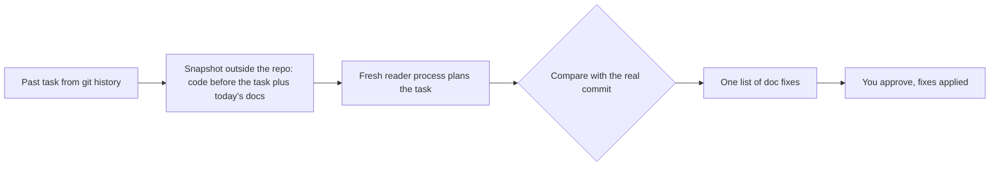

# Build docs your coding agents can work from

[](https://www.npmjs.com/package/agent-docs-bootstrap)
[](https://github.com/TraneDev/agent-docs-bootstrap/actions/workflows/check.yml)
[](LICENSE)

**agent-docs-bootstrap** is a set of agent skills and instructions, not tied to one tool. It interviews your team and writes the glossary, decision records, architecture, how-tos and `AGENTS.md` that coding agents and new developers need. If you want to see how well they work, an **optional** check has a fresh agent plan a task from the docs alone: one you bring, or real past tasks from your git history compared with the commits that solved them.

The installer sets up **Claude Code**, **Codex** and **OpenCode**. Any other agent that runs skills can use the two skill folders as they are: see [Other agents](#other-agents).

[Quick start](#quick-start) · [How it works](#how-it-works) · [Optional: test the docs](#optional-test-the-docs-with-docs-check) · [Install options](#install-options) · [Harness differences](#harness-differences)

## Quick start

You need Node.js 18+ and a git repository.

1. From your project root, install the skills and subagents:

   ```bash
   npx agent-docs-bootstrap@0.2.0 --target claude
   ```

   Replace `claude` with `codex`, `opencode`, a list such as `claude,codex`, or `all`.

2. Commit what was installed, so the whole team runs the same version:

   ```bash
   git add .agent-docs-bootstrap .claude
   git commit -m "Add agent-docs-bootstrap"
   ```

   For Codex and OpenCode, add `.agents` and `.codex` or `.opencode` instead of `.claude`.

3. Restart the agent session and start the build:

   | Harness | Build the docs | Test the docs (optional) |
   |---|---|---|
   | Claude Code | `/docs-bootstrap` | `/docs-check` |
   | Codex | `$docs-bootstrap` | `$docs-check` |
   | OpenCode | `/docs-bootstrap` | `/docs-check` |

   Or just ask: "document this project", "test our docs with a fresh reader".

Progress is saved in `docs/agents/bootstrap-state.md`, so you can stop and continue in a later session.

## How it works

### Build the docs: `docs-bootstrap`

The work goes in stages. Each stage ends with a stop for your review.

| Stage | Result |
|---|---|
| 1. Inventory | Confirmed stack, verified commands, existing docs |
| 1.5. External docs audit | What in Confluence, Notion or a wiki is current, outdated or missing (skipped without external docs) |
| 2. Domain | `CONTEXT.md` glossary and ADRs, through a structured interview |
| 3. Architecture | `docs/architecture.md` with C4 Context and Container diagrams |
| 4. How-to | `docs/how-to/*.md` for recurring tasks |
| 5. AGENTS.md | Root and nested `AGENTS.md`, wired up for Claude Code too |

A new project gets a shorter track: interview the idea, plan the architecture, write a starter `AGENTS.md`, and review after the first features.

External documentation is read through whatever MCP server your session already has. The kit does not ship or configure one.

### Optional: test the docs with `docs-check`

The build does not depend on it, and it costs a separate agent process per task, several minutes each. Use it when you want to see where a fresh agent stumbles on your docs, or to collect numbers across projects. It is a diagnostic: it shows gaps, it does not prove the docs good.

**Own task.** Give it a task in your words, for example a ticket you are about to start. A fresh reader plans it from a snapshot of the current commit and your docs; you read the plan, what it had to guess and its questions, and decide what the docs should have answered.

**History.** Three real past tasks, compared with the commits that solved them. Best run a few weeks after the build, on commits the docs could not know:



1. The agent picks three real past tasks from git history, preferring commits made after the docs were written, and drops any whose solution is already in the code or the docs.
2. For each task, the code is extracted **as it was before the task**, outside your repository, and your current documents from the working tree go on top.
3. A fresh reader plans the task. It runs as a **separate process** of your harness (`claude -p`, `codex exec`, `opencode run`), read-only, with no history and no MCP tools, in a snapshot outside your repository: a subagent of the same session could find the solution in your current code. Claude Code and OpenCode keep the reader's file access inside the snapshot; Codex's read-only sandbox blocks writes but not reading elsewhere, so there only the reader's instructions keep it in the snapshot (see [Harness differences](#harness-differences)).
4. Its plan is compared with what the real commit changed. Missed files, missed verification commands, wrong terms, rejected approaches and guesses are **gaps**.
5. The gaps become one list of fixes, grouped by document. You strike out what came from a poor commit rather than the docs, and the rest is applied.

The same tasks are not rerun after the fixes: the docs now hold their answers, so a rerun would pass without proving anything. The next check runs on new tasks.

No LLM judges the plans, because an LLM judge prefers the longer, more confident plan. The real commit is the reference.

### Rules it keeps

- **Code says "what", people say "why".** Reasons for decisions, canonical terms and boundaries come only from a human. The agent asks; it does not invent.
- **Only confirmed content is committed.** Scout drafts stay in a git-ignored scratch folder.
- **Existing docs are extended, never overwritten.**
- **Secrets never reach the docs.** Passwords, tokens and keys are not written down, only where to get them.

## Install options

All options run the same installer from your project root. Pin the version: the whole team then installs the same one, and `npx` does not serve an older copy from its cache.

**From npm** (recommended):

```bash
npx agent-docs-bootstrap@0.2.0 --target claude
```

**From a GitHub release tag**, when the npm registry is blocked or unavailable:

```bash
npx github:TraneDev/agent-docs-bootstrap#v0.2.0 --target claude
```

**From a clone**, to read or change the kit first:

```bash
git clone --branch v0.2.0 https://github.com/TraneDev/agent-docs-bootstrap.git ~/agent-docs-bootstrap
node ~/agent-docs-bootstrap/install.mjs --target claude
```

### What gets installed

Files are copied into the project, not linked, so they get committed with it.

| Target | Skills | Subagents |
|---|---|---|
| `claude` | `.claude/skills/` | `.claude/agents/*.md` |
| `codex` | `.agents/skills/` | `.codex/agents/*.toml` |
| `opencode` | `.agents/skills/` | `.opencode/agents/*.md`, plus `/docs-bootstrap` and `/docs-check` commands |

Two skills are installed, `docs-bootstrap` and `docs-check`. The guides by other authors that `docs-bootstrap` relies on travel inside it, in `docs-bootstrap/vendor/`, and are not registered as skills, so a skill of yours with the same name, such as `grilling`, never clashes with them.

`.agent-docs-bootstrap` lists every installed path. The installer replaces or removes only those paths and never touches files it did not create: a path that already exists and is not listed there is skipped with a warning, and a line in the marker that is not shaped like a path the kit installs (for example `src` or `../x`, added by a bad merge) is ignored with a warning.

### Other agents

The skills are plain `SKILL.md` folders with Markdown references and templates. For an agent the installer does not know, copy `skills/docs-bootstrap` and `skills/docs-check` from a clone (see above) into the folder where that agent looks for skills, and start it with "document this project". An agent without skill support can be pointed at `docs-bootstrap/SKILL.md` directly.

What changes without the installer's targets:

- **No subagents.** `docs-bootstrap` does the scout's briefs itself and keeps only summaries in the conversation.
- **`docs-check`** builds the snapshot with `reader-run.mjs --snapshot-only`; you start a fresh session of your agent in that folder and paste the task. Starting the reader automatically works only with `claude`, `codex` and `opencode`.

### Update or remove

- **Update:** run the installer again with the new version and commit the result. Paths the previous version installed and this one no longer ships are removed.
- **Remove:** run it with `--uninstall`. Everything listed in `.agent-docs-bootstrap` is deleted, along with the marker itself.

<details>
<summary>All installer flags</summary>

| Flag | Effect |
|---|---|
| `--target <list>` | `claude`, `codex`, `opencode`, a comma-separated list, or `all`. Required to install. |
| `--project <dir>` | Install into `<dir>` instead of the current directory. |
| `--global` | Install into your home directory instead of a project. Codex agents go to `$CODEX_HOME`, OpenCode files to `$OPENCODE_CONFIG_DIR`, when those are set. |
| `--scout-model <id>`, `--reader-model <id>` | Pin the subagent models. By default they inherit the session model. A flag applies to every target in that run, so run the installer once per target to pin different models per harness. |
| `--yes` | Do not stop when the directory has no `.git`. |
| `--uninstall` | Remove everything listed in `.agent-docs-bootstrap`. |
| `--help` | Print usage. |

</details>

## Harness differences

The protocol is the same everywhere; how strictly each harness can enforce the limits is not.

| Guarantee | Claude Code | Codex | OpenCode |
|---|---|---|---|
| Reader cannot see the solution or history | Snapshot outside the repo, no history; `--restricted` keeps file tools inside it | Snapshot outside the repo, no history; reading other folders is not blocked, only the prompt forbids it | Snapshot outside the repo, no history; `external_directory: deny` |
| Reader cannot edit or run commands | `--restricted --tools Read,Grep,Glob` | `-s read-only` sandbox | Permissions (`"*": deny`) |
| Scout writes only to the scratch folder | Instructions (edit tool removed) | Instructions only | Path permissions |
| External docs are never modified | Instructions | Instructions | Instructions |
| Scout reads the bundled guides | File tools | File tools | Read permission; a `--global` install is outside the project, so `external_directory` asks once |

Where a guarantee is "instructions only", tighten it with your harness's own permission settings if you need to. For example, deny the write tools of your wiki's MCP server.

## Repository layout

```text
skills/docs-bootstrap/   orchestrator: SKILL.md, references/ (formats, scout briefs), templates/,
                         vendor/ (guides by other authors, each with its LICENSE)
skills/docs-check/       optional reader test: SKILL.md, templates/, scripts/reader-run.mjs (snapshot and reader process)
agents/                  docs-scout, docs-reader: one prompt + per-harness frontmatter blocks
package.json             npm package metadata and the version
install.mjs              installer (the package's `bin`)
scripts/check.mjs        repository checks (CI)
```

To work on the kit itself, start with [AGENTS.md](AGENTS.md) and run `node scripts/check.mjs` before you commit.

## Credits

The workflow builds on skills by other authors, bundled inside `docs-bootstrap` under their licenses, unmodified except that each `SKILL.md` is renamed so it does not register as a separate skill. Pinned commits and update steps are in [THIRD_PARTY.md](THIRD_PARTY.md).

- Matt Pocock, [mattpocock/skills](https://github.com/mattpocock/skills): `domain-modeling`, `grilling` and `writing-for-agents` (MIT).
- Georges Martin, [jrjsmrtn/diataxis-skills](https://github.com/jrjsmrtn/diataxis-skills): `diataxis-audit` (MIT).
- Anthropic, [anthropics/skills](https://github.com/anthropics/skills): `doc-coauthoring` (Apache 2.0).

## License

[MIT](LICENSE) for the kit's own files. Bundled third-party guides keep their own licenses.
