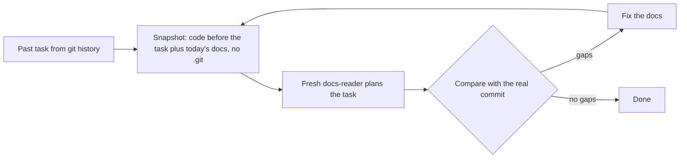

# agent-docs-bootstrap

[](https://www.npmjs.com/package/agent-docs-bootstrap)
[](https://github.com/TraneDev/agent-docs-bootstrap/actions/workflows/check.yml)
[](LICENSE)

Build reference documentation for a codebase so that coding agents and new developers can work in it. Then **test** it: a fresh agent plans real past tasks from your git history, and every gap against the real commit becomes a fix in the docs.

Works with **Claude Code**, **Codex** and **OpenCode**.

[Quick start](#quick-start) · [How it works](#how-it-works) · [Install options](#install-options) · [Harness differences](#harness-differences)

## Quick start

You need Node.js 18+ and a git repository.

1. From your project root, install the skills and subagents:

   ```bash
   npx agent-docs-bootstrap@0.1.0 --target claude
   ```

   Replace `claude` with `codex`, `opencode`, a list such as `claude,codex`, or `all`.

2. Commit what was installed, so the whole team runs the same version:

   ```bash
   git add .agent-docs-bootstrap .claude
   git commit -m "Add agent-docs-bootstrap"
   ```

   For Codex and OpenCode, add `.agents` and `.codex` or `.opencode` instead of `.claude`.

3. Restart the agent session and start the build:

   | Harness | Build the docs | Check the docs |
   |---|---|---|
   | Claude Code | `/docs-bootstrap` | `/docs-check` |
   | Codex | `$docs-bootstrap` | `$docs-check` |
   | OpenCode | `/docs-bootstrap` | `/docs-check` |

   Or just ask: "document this project", "check our docs with a reader test".

Progress is saved in `docs/agents/bootstrap-state.md`, so you can stop and continue in a later session.

## How it works

### Build the docs: `docs-bootstrap`

The work goes in stages. Each stage ends with a stop for your review.

| Stage | Result |
|---|---|
| 1. Inventory | Confirmed stack, verified commands, existing docs |
| 1.5. External docs audit | What in Confluence, Notion or a wiki is current, outdated or missing (skipped without external docs) |
| 2. Domain | `CONTEXT.md` glossary and ADRs, through a structured interview |
| 3. Architecture | `docs/architecture.md` with C4 Context and Container diagrams |
| 4. How-to | `docs/how-to/*.md` for recurring tasks |
| 5. AGENTS.md | Root and nested `AGENTS.md`, wired up for Claude Code too |
| 6. Reader test | Gaps a fresh agent hits, fixed |

A new project gets a shorter track: interview the idea, plan the architecture, write a starter `AGENTS.md`, and review after the first features.

External documentation is read through whatever MCP server your session already has. The kit does not ship or configure one.

### Test the docs: `docs-check`

Whether the documentation helps an agent is answered with an experiment, not an opinion:



1. Three real past tasks are taken from git history. The agent picks them, or you pick them from its candidates: about 10 minutes, and the check gets more accurate.
2. For each task, the code is extracted **as it was before the task**, and your current documents from the working tree go on top.
3. A fresh `docs-reader` subagent with no history, no git and no edit rights plans the task.
4. Its plan is compared with what the real commit changed. Missed files, missed verification commands, wrong terms, rejected approaches and guesses are **gaps**.
5. Each gap becomes a concrete fix in the docs, and the task is rerun until the plan has none.

No LLM judges the plans, because an LLM judge prefers the longer, more confident plan. The real commit is the reference.

### Rules it keeps

- **Code says "what", people say "why".** Reasons for decisions, canonical terms and boundaries come only from a human. The agent asks; it does not invent.
- **Only confirmed content is committed.** Scout drafts stay in a git-ignored scratch folder.
- **Existing docs are extended, never overwritten.**

## Install options

All options run the same installer from your project root. Pin the version: the whole team then installs the same one, and `npx` does not serve an older copy from its cache.

**From npm** (recommended):

```bash
npx agent-docs-bootstrap@0.1.0 --target claude
```

**From a GitHub release tag**, when the npm registry is blocked or unavailable:

```bash
npx github:TraneDev/agent-docs-bootstrap#v0.1.0 --target claude
```

**From a clone**, to read or change the kit first:

```bash
git clone --branch v0.1.0 https://github.com/TraneDev/agent-docs-bootstrap.git ~/agent-docs-bootstrap
node ~/agent-docs-bootstrap/install.mjs --target claude
```

### What gets installed

Files are copied into the project, not linked, so they get committed with it.

| Target | Skills | Subagents |
|---|---|---|
| `claude` | `.claude/skills/` | `.claude/agents/*.md` |
| `codex` | `.agents/skills/` | `.codex/agents/*.toml` |
| `opencode` | `.agents/skills/` | `.opencode/agents/*.md`, plus `/docs-bootstrap` and `/docs-check` commands |

`.agent-docs-bootstrap` lists every installed path. The installer replaces or removes only those paths and never touches files it did not create.

### Update or remove

- **Update:** run the installer again with the new version and commit the result.
- **Remove:** run it with `--uninstall`. Everything listed in `.agent-docs-bootstrap` is deleted, along with the marker itself.

<details>
<summary>All installer flags</summary>

| Flag | Effect |
|---|---|
| `--target <list>` | `claude`, `codex`, `opencode`, a comma-separated list, or `all`. Required to install. |
| `--project <dir>` | Install into `<dir>` instead of the current directory. |
| `--global` | Install into your home directory instead of a project. Codex agents go to `$CODEX_HOME`, OpenCode files to `$OPENCODE_CONFIG_DIR`, when those are set. |
| `--scout-model <id>`, `--reader-model <id>` | Pin the subagent models. By default they inherit the session model. A flag applies to every target in that run, so run the installer once per target to pin different models per harness. |
| `--yes` | Do not stop when the directory has no `.git`. |
| `--uninstall` | Remove everything listed in `.agent-docs-bootstrap`. |
| `--help` | Print usage. |

</details>

## Harness differences

The protocol is the same everywhere; how strictly each harness can enforce the subagent limits is not.

| Guarantee | Claude Code | Codex | OpenCode |
|---|---|---|---|
| Reader cannot see git history | Snapshot has no `.git` | Snapshot has no `.git` | Snapshot has no `.git` + read deny |
| Reader cannot edit or run commands | Tool allowlist (`Read, Grep, Glob`) | Instructions only | Permissions |
| Scout writes only to the scratch folder | Instructions (edit tool removed) | Instructions only | Path permissions |
| External docs are never modified | Instructions | Instructions | Instructions |

Where a guarantee is "instructions only", tighten it with your harness's own permission settings if you need to. For example, deny the write tools of your wiki's MCP server.

## Repository layout

```text
skills/docs-bootstrap/   orchestrator: SKILL.md, references/ (formats, scout briefs), templates/
skills/docs-check/       the reader test
skills/third-party/      skills by other authors, unmodified, each with its LICENSE
agents/                  docs-scout, docs-reader: one prompt + per-harness frontmatter blocks
package.json             npm package metadata and the version
install.mjs              installer (the package's `bin`)
scripts/check.mjs        repository checks (CI)
```

To work on the kit itself, start with [AGENTS.md](AGENTS.md) and run `node scripts/check.mjs` before you commit.

## Credits

The workflow builds on skills by other authors, bundled unmodified under their licenses. Pinned commits and update steps are in [THIRD_PARTY.md](THIRD_PARTY.md).

- Matt Pocock, [mattpocock/skills](https://github.com/mattpocock/skills): `domain-modeling`, `grilling`, `grill-with-docs` and `writing-for-agents` (MIT).
- Georges Martin, [jrjsmrtn/diataxis-skills](https://github.com/jrjsmrtn/diataxis-skills): `diataxis-audit` (MIT).
- Anthropic, [anthropics/skills](https://github.com/anthropics/skills): `doc-coauthoring` (Apache 2.0).

## License

[MIT](LICENSE) for the kit's own files. Third-party skills keep their own licenses.
